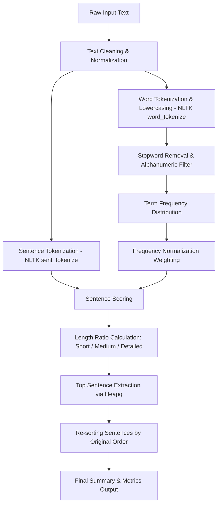

# Automatic Text Summarization Tool

An NLP-powered full-stack web application designed for automatic extractive text summarization of articles, study materials, research papers, and documents. Built with **Python Flask**, **NLTK**, **SQLite**, and modern **HTML5/CSS3/JavaScript**.

---

## 📌 Project Overview

Automatic Text Summarization is a core application in Natural Language Processing (NLP). This tool condenses extensive textual content into a concise summary while retaining the most informative sentences and key concepts.

The application utilizes an **Extractive Summarization Algorithm** based on statistical sentence scoring and Term Frequency (TF) weighting. The system cleans raw text, tokenizes sentences and words, filters out English stopwords, normalizes term frequencies, scores candidate sentences, and selects top-ranking sentences while preserving narrative structure.

---

## ⚙️ Key Features

1. **Large Text Input**: Multi-line text entry for long articles, documents, and research papers.
2. **Extractive NLP Engine**: Custom NLTK-backed pipeline implementing term frequency sentence ranking.
3. **Flexible Summary Length Settings**:
   - **Short** (~20% extraction ratio)
   - **Medium** (~35% extraction ratio)
   - **Detailed** (~50% extraction ratio)
4. **Comprehensive Text Analytics**: Real-time word counts, sentence count transition, and calculated compression percentage ($100 \times (1 - \frac{\text{Summary Words}}{\text{Original Words}})$).
5. **Sample Text Loader**: One-click quick fill with pre-loaded academic NLP study text.
6. **Clipboard & Utility Actions**: Quick paste, clear input, one-click copy summary, and TXT file export.
7. **SQLite History Persistence**: Stores past summarization results (original text, summary, length mode, metrics, timestamp) in a local database with full load and deletion capabilities.
8. **Short Text Handling**: Intelligently handles edge cases (e.g. text under 3 sentences or 30 words) by presenting full text with informative notifications to avoid context loss.
9. **Responsive UI**: Glassmorphic dashboard styled with CSS grid/flexbox, custom icons, dark mode theme, and toast alerts.

---

## 🧠 NLP Extractive Summarization Theory & Algorithm

Extractive summarization selects sentences directly from the source text based on statistical importance scoring.



### Mathematical Formulation

1. **Term Frequency Calculation ($TF$)**:
   For each unique non-stopword token $w$ in the document vocabulary $V$:
   $$f(w) = \text{Count of word } w \text{ in text}$$
   $$\text{Max Frequency } M = \max_{w \in V} f(w)$$

2. **Normalized Word Weight ($W_f$)**:
   $$W_f(w) = \frac{f(w)}{M}$$

3. **Sentence Scoring ($Score(S_i)$)**:
   For sentence $S_i$ containing valid tokens $\{w_1, w_2, \dots, w_k\}$:
   $$Score(S_i) = \frac{\sum_{j=1}^{k} W_f(w_j)}{\sqrt{k}}$$
   *(A length factor $\sqrt{k}$ is applied to normalize against bias toward unnaturally long sentences.)*

4. **Selection & Sequence Ordering**:
   The top $N$ sentences with maximum $Score(S_i)$ are chosen according to the selected ratio ($20\%, 35\%, 50\%$) and sorted by their original sentence index $i$ to maintain context sequence.

---

## 📁 Project Structure

```
text_summarization_tool/
├── backend/
│   ├── __init__.py         # Package initialization
│   ├── app.py              # Flask server routes & REST API
│   ├── database.py         # SQLite connection & CRUD operations
│   └── summarizer.py       # Core NLTK NLP summarization engine
├── data/
│   └── summaries.db        # SQLite database (auto-generated)
├── static/
│   ├── css/
│   │   └── style.css       # Modern responsive CSS styling
│   └── js/
│       └── main.js         # Frontend interactive logic & AJAX
├── templates/
│   └── index.html          # Main application UI dashboard
├── requirements.txt        # Python package dependencies
└── README.md               # Academic documentation & guide
```

---

## 🚀 Installation & Prerequisites

### Prerequisites
- **Python 3.8+** installed on system.
- Git (optional).

### Setup Instructions

1. **Navigate to project directory**:
   ```bash
   cd C:\Users\sueen\.gemini\antigravity\scratch\text_summarization_tool
   ```

2. **(Optional) Create and activate a Virtual Environment**:
   ```bash
   # Windows
   python -m venv venv
   venv\Scripts\activate

   # macOS/Linux
   python3 -m venv venv
   source venv/bin/activate
   ```

3. **Install Dependencies**:
   ```bash
   pip install -r requirements.txt
   ```

   *Dependencies included:*
   - `Flask>=2.0.0`
   - `nltk>=3.8.0`

---

## 💻 Execution Instructions

1. **Launch the Flask Server**:
   ```bash
   python backend/app.py
   ```

2. **Access Web Application**:
   Open your browser and navigate to:
   ```
   http://127.0.0.1:5000
   ```

---

## 📡 REST API Reference

### 1. `POST /api/summarize`
Generates an extractive summary for provided text.

**Request Body (JSON)**:
```json
{
  "text": "Your long article text goes here...",
  "length": "medium"
}
```
*`length` options: `"short"`, `"medium"`, `"detailed"`.*

**Response (JSON)**:
```json
{
  "success": true,
  "history_id": 1,
  "summary": "Condensed summary sentence...",
  "original_word_count": 250,
  "summary_word_count": 85,
  "compression_rate": 66.0,
  "original_sentence_count": 12,
  "summary_sentence_count": 4,
  "is_short_text": false,
  "message": ""
}
```

### 2. `GET /api/history`
Fetches list of all saved summary records from SQLite database.

### 3. `DELETE /api/history/<id>`
Deletes a specific summary record by ID.

### 4. `DELETE /api/history`
Clears all summary history records.

### 5. `GET /api/sample`
Returns sample academic study material for testing.

---

## 🗄️ SQLite Database Schema

The application uses an embedded SQLite database stored in `data/summaries.db`.

```sql
CREATE TABLE IF NOT EXISTS summaries (
    id INTEGER PRIMARY KEY AUTOINCREMENT,
    original_text TEXT NOT NULL,
    summary_text TEXT NOT NULL,
    length_setting TEXT NOT NULL DEFAULT 'medium',
    original_word_count INTEGER NOT NULL,
    summary_word_count INTEGER NOT NULL,
    compression_rate REAL NOT NULL,
    created_at TIMESTAMP DEFAULT CURRENT_TIMESTAMP
);
```

---

## 🎓 Academic Assignment Context

This application was developed as a complete capstone submission for **Text & Speech Analysis**. It demonstrates:
- **Natural Language Preprocessing**: Tokenization, Stopword filtering, and Text normalization.
- **Statistical Information Retrieval**: Frequency weighting and TF sentence relevance scoring.
- **Full-stack System Integration**: Micro-architecture pairing Flask REST APIs with an interactive HTML5/CSS3 dynamic frontend and SQLite persistence.

---

## 📜 License

This project is created for educational and academic demonstration purposes.
